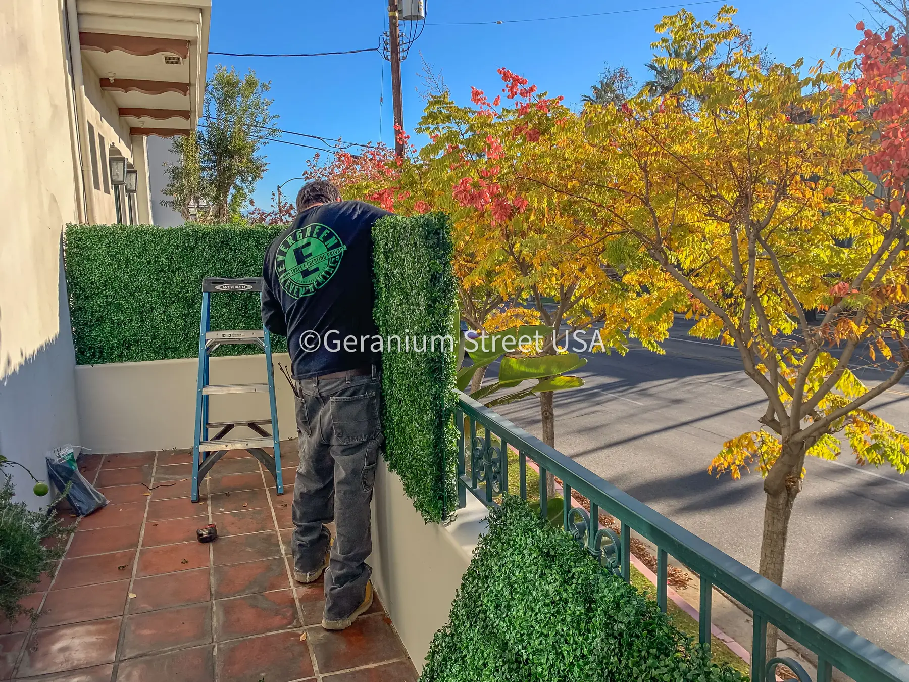
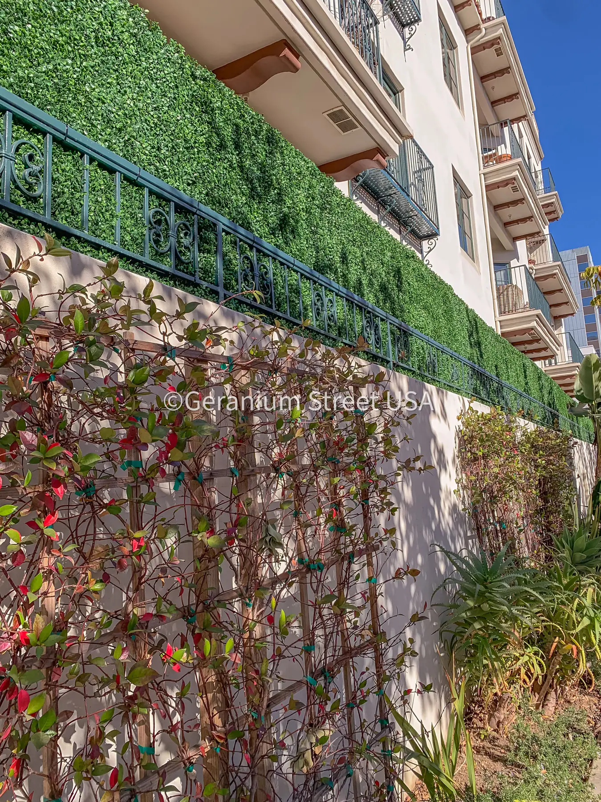
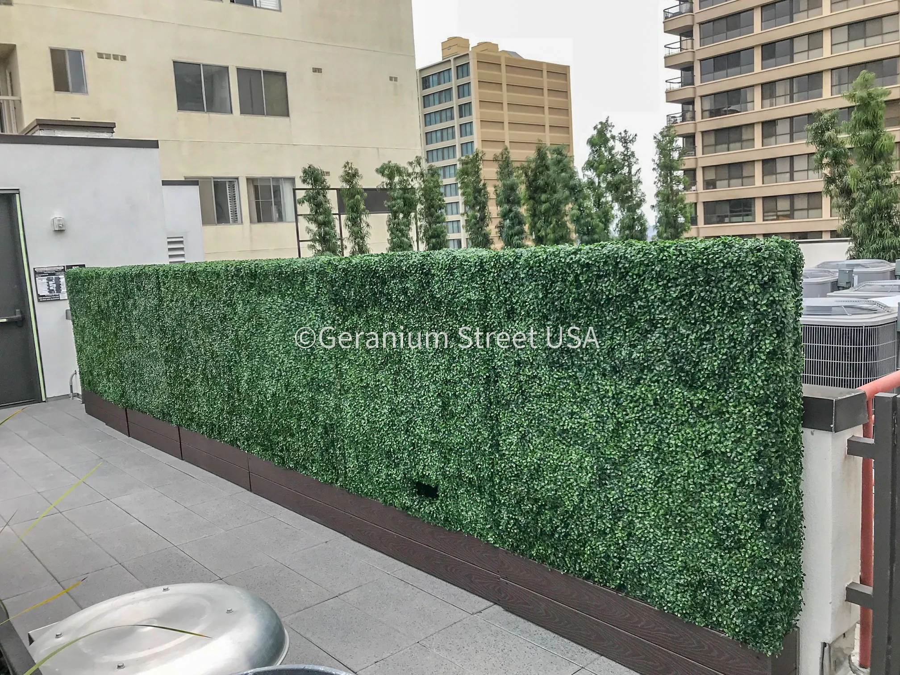

When you add up the initial purchase, installation, water bills, and ongoing maintenance, **artificial hedges are often cheaper than real plants for Texas homeowners over the long run.** While a live hedge may have a lower sticker price, the relentless Texas climate turns it into a money pit of water, labor, and replacement costs.

This detailed cost breakdown will show you exactly where your money goes with both options, proving why so many Texans are switching to high-quality artificial greenery for a beautiful, permanent, and cost-effective landscape.

## The Upfront Cost: Purchase & Installation

Let's start with what you pay at the register and to get it in the ground.

**Real Hedge Plants:** For common screening plants like Ligustrum (Privet), Indian Hawthorn, or Dwarf Yaupon Holly, a Texas nursery prices them by the plant, and a dense 10-foot linear hedge may need 8-10 plants. Professional installation adds more, depending on soil prep, labor, and size of the project.

**Artificial Hedges (Premium Quality):** Commercial-grade, UV-stabilized artificial hedge panels are priced per panel or per foot, and a 10-foot span might need 5-10 panels. Professional installation by a specialist like Lone Star Faux Scapes helps ensure a secure fit and is quoted after a site review. Starting prices are published on the [pricing page](/pricing) (installation is quoted after a site review).

**Verdict:** The initial costs can be comparable. A cheap live hedge can *seem* less expensive, but a proper installation with good soil amendments and healthy plants brings the price close to a premium artificial solution right from the start.

## The Hidden Killer: Long-Term Maintenance Costs in Texas

This is where artificial hedges pull decisively ahead. The Texas sun, sporadic droughts, and soil conditions create relentless ongoing expenses for live plants.

**The Real Cost of a "Drought-Tolerant" Live Hedge in Texas:**
*   **Water:** Even "drought-tolerant" plants need significant water to establish and survive a Texas summer. Expect to use **hundreds to thousands of gallons annually**, and with rising water rates that shows up on your bill.
*   **Fertilizer & Soil Amendments:** Texas soil often needs help. Yearly fertilizing, compost, or pH balancers are a recurring cost.
*   **Pest & Disease Control:** From aphids to fungal diseases, treatments are often necessary, and each one adds up.
*   **Trimming & Pruning:** To keep it tidy, professional trimming several times a year is a recurring service. DIY saves money but costs you time and effort.
*   **Replacement:** A bad freeze (like Uri), a drought, or disease can wipe out sections. Plan on replacing plants every few years.

**The Long-Term Cost of an Artificial Hedge:**
*   **Water:** None.
*   **Fertilizer/Soil:** None.
*   **Pest Control:** None.
*   **Trimming:** None. It never grows.
*   **Maintenance:** Occasional rinsing with a hose to remove dust (minimal water use). Ask any supplier for UV and fade warranty terms in writing.

**Long-Term Cost Comparison (10-Foot Hedge):**

| Cost Factor | Real Hedge | Artificial Hedge |
| :--- | :--- | :--- |
| **Initial Purchase & Install** | Plants, soil prep and labor | Panels, mounting and installation |
| **Water** | Ongoing, and it rises with water rates | None |
| **Trimming/Maintenance** | Recurring | None |
| **Soil/Fertilizer/Pest** | Recurring | None |
| **Replacements** | Possible after a freeze, drought or disease | Not usually needed; ask for warranty terms in writing |
| **Overall** | Costs keep coming back | Mostly upfront |

The difference is the ongoing cost: the artificial hedge avoids most of it, and for many Texas homeowners that can add up over the years.

## Answering Your Top Questions: Real vs. Artificial in Texas

### How long do artificial hedges last in the Texas sun?
Premium artificial hedges made with UV-inhibited materials can hold their appearance for years in Texas conditions, but the real lifespan depends on sun exposure, product quality, installation method, and upkeep. Better outdoor products generally perform more consistently than cheap imports that were never built for full-time sun exposure.

### Is a "drought-tolerant" real hedge actually cheaper?
No, not when you factor in total cost of ownership. While plants like Cenizo or Mountain Laurel survive on less water, they still require:
*   Heavy watering for the first 1-2 years to establish.
*   Increased watering during drought declarations and extreme heat (105°F+ days).
*   All the other costs of pruning, soil care, and potential loss. Their initial cost is lower, but their lifetime cost remains high.

### Can an artificial hedge withstand Texas storms and wind?
Yes, when installed correctly. Professional installation uses heavy-duty framing, industrial-grade fasteners, and secure substrates anchored to walls or posts. We design for Texas weather, and the right mounting depends on your site, so ask about wind loads during the site review.

### Do artificial hedges look fake?
Not anymore. High-fidelity artificial hedges use varied leaf colors, textures, and randomized patterns to mimic nature. From a few feet away, the best are indistinguishable from real plants, without the brown spots, wilting, or inconsistent growth.

### Which option is better for my property value?
Both can enhance curb appeal. Artificial hedges offer a unique, **permanently perfect** look that requires no work from future homeowners, a selling point for the low-maintenance lifestyle. They are a finished landscaping feature, not a future chore.

## Local Texas Considerations You Can't Ignore

*   **Water Restrictions:** Many Texas municipalities enact seasonal or permanent water restrictions. Your live hedge can become a liability, potentially browning under water rationing. Artificial hedges are compliance-proof.
*   **Soil Challenges:** Clay soil, caliche rock, and alkaline conditions limit what will thrive and add to amendment costs. Artificial hedges eliminate soil problems entirely.
*   **Extreme Weather Resilience:** A well-installed artificial hedge will look perfect the day after a hail storm or a hard freeze that devastates live plants. This reliability saves money and stress.

## The Bottom Line for Texas Homeowners

If you're looking only at the price tag on a small plant at the nursery, real seems cheaper. But for any homeowner who values their time, water resources, and long-term budget, **artificial hedges are often the cheaper choice for Texas landscapes.**

The investment in a quality artificial hedge from a trusted Texas supplier can pay for itself in saved water bills, eliminated landscaping fees, and the peace of mind of a green, lush barrier that holds up to whatever the climate throws at it. You're not just buying a product; you're buying freedom from yard work and unpredictable costs.

---

## Related articles

This article is part of our [complete guide to artificial hedges in Texas](/blog/the-complete-guide-to-artificial-hedges-in-texas), which covers types, materials, climate performance, HOA approval, and more.

You might also find these useful:
- [Artificial vs. real boxwood in Texas: water, maintenance, and long-term value](/blog/artificial-vs-real-boxwood-texas)
- [Faux green walls vs. real plants for Texas homes](/blog/faux-green-walls-vs-real-plants-for-texas-homes)

---

### FAQ: Artificial Hedge Costs in Texas

**Q: What is the price per square foot for an artificial hedge in Texas?**
A: Starting prices are published on the [pricing page](/pricing) (installation is quoted after a site review). The final figure depends on the product, the size and the site.

**Q: Do I need a permit to install an artificial hedge fence in Texas?**
A: Permit requirements depend on the city, how the hedge is mounted, and whether you are modifying an existing fence or adding structural elements. Check local requirements and HOA rules before installing.

**Q: Can I install an artificial hedge myself to save money?**
A: While DIY kits exist, professional installation is highly advised in Texas. Experts ensure proper waterproofing, wind resistance, and a seamless look that lasts, avoiding costly mistakes or flimsy installations that fail in high winds.

**Q: How do I clean an artificial hedge in dusty Texas?**
A: Simply rinse it with a garden hose now and then. For stubborn dust, use a mild soap solution. It takes minutes, not hours.

**Q: Where can I see artificial hedge samples in Texas?**
A: Contact Lone Star Faux Scapes. We serve homeowners across Texas. Send your numbers and we email an assessment and a rough quote (with a 3D render when it helps); a site review sets the final invoice.
