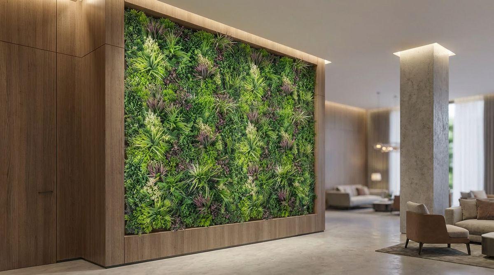
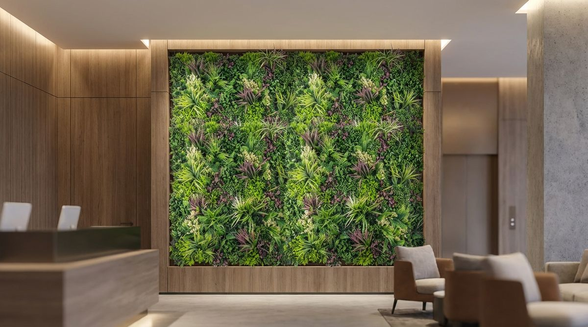

## Introduction  
Texas homeowners face a unique dilemma when considering living walls. The scorching summers, unpredictable storms, and water restrictions make traditional plant walls a challenge. But artificial alternatives come with their own trade-offs.  

This isn't just about aesthetics, it's about durability against 110°F heat, surviving hailstorms, and whether you'll spend weekends pruning or relaxing. We'll break down installation costs, how each handles Texas weather, and which option actually increases property value.  

The decision impacts your home's microclimate too. Real plants can cool surrounding areas through evapotranspiration, while advanced artificial materials now incorporate heat-reflective properties. We'll examine how both perform in different Texas regions, from the humid Gulf Coast to the arid Trans-Pecos.  

## The Water Problem Nobody Talks About  
Real living walls in Texas can require more water than ground-level landscaping. Municipal restrictions in cities like Austin and San Antonio often prohibit the necessary irrigation. Artificial walls eliminate water use entirely, a selling point during drought years.  

But there's a catch. Cheap plastic plants can fade under UV exposure. High-quality faux greenery uses UV-stabilized materials that resist yellowing. The best options mimic natural transpiration with textured surfaces that prevent heat buildup.  

Water requirements vary dramatically by plant selection, and drip systems can lose more water to evaporation in vertical setups versus ground irrigation. Some homeowners install rainwater collection systems, but these add to project costs.  

For artificial walls, cleaning methods affect water savings. Pressure washing uses water, while electrostatic dust removal systems use none. Consider your local water rates: real walls can add noticeably to utility bills.  

## When hail and storms hit {#when-hail-hits-at-70-mph}
Texas storms destroy real plants in minutes. A single hailstorm can shred delicate leaves, requiring complete replanting. Artificial walls withstand impact better, but only if they're installed with reinforced backing systems.  

Ask what wind loads the mounting system is designed for, especially in coastal areas. Real living walls need protective covers during severe weather alerts.  

For real walls, select resilient species like yucca or agave that can regenerate after storm damage. In hail-prone areas like the Texas Panhandle, artificial walls with flexible stems better absorb impact energy without permanent deformation.  

  

## The Hidden Maintenance Trap  
Real living walls demand weekly attention:  
- Pruning overgrowth that blocks windows  
- Treating mold from humidity  
- Replacing plants that scorch in direct sun  

Artificial versions need quarterly cleaning with a leaf blower or gentle hose spray. But they collect dust faster than you'd expect, especially near highways where particulate pollution settles.  

Maintenance timelines reveal stark differences:  
| Task | Real Walls | Artificial Walls |  
|------|-----------|------------------|  
| Pruning | Weekly | Never |  
| Fertilizing | Monthly | Never |  
| Pest Control | Seasonal | Never |  
| Deep Cleaning | Never | Quarterly |  
| Component Replacement | Annual | As needed (ask for warranty terms) |  

Real walls require specialized care, pH-balanced fertilizers, root zone monitoring, and seasonal plant rotation. Artificial walls develop maintenance needs over time: UV coating reapplication, stem reinforcement, and color touch-ups over time.  

## What drives installation cost {#installation-costs-that39ll-surprise-you}
Professional installation of real living walls often costs more up front because of:  
- Irrigation systems  
- Structural reinforcements for weight  
- Frequent plant replacements  

Artificial walls are priced by system and size, and installation is quoted after a site review. Starting prices are published on the [pricing page](/pricing) (installation is quoted after a site review). Over time, the water bills and maintenance labor of real walls can close the gap.  

Cost components vary significantly:  

**Real Walls**  
- Structural assessment  
- Irrigation system  
- Plants  
- Annual maintenance contract  

**Artificial Walls**  
- Custom framing  
- UV-resistant panels  
- Installation hardware  
- Cleaning service (optional)  

Financing options differ too, so ask each supplier what they offer.  

## Which Actually Boosts Home Value?  
Realtors report artificial walls appeal to buyers in drought-prone areas. They're seen as "move-in ready" features. Real plant walls attract eco-conscious buyers but can deter those wary of maintenance.  

Appraisers may value either as a landscaping feature, and the return varies. The key is choosing an option that complements your home's architecture. Mediterranean styles suit real herbs, while modern designs pair well with structured artificial panels.  

Consider your selling timeline. Real walls take time to fill in, while artificial walls deliver immediate impact. For investment properties, artificial walls avoid tenant maintenance issues.  

## Fire Ratings Matter More Than You Think  
Some codes require flame retardancy for certain installations, so check with your local authority. Fire-rated options are built for NFPA 701; ask for the NFPA 701 documentation for the exact system you choose[1]. Real plants, by contrast, can become fuel during wildfire season.  

This is critical for homes near brush areas. Some HOAs may require fire-resistant landscaping, so check your covenants.  

Fire performance comparisons:  
- Real walls: flame behavior varies by plant type, and dry plants burn  
- Artificial walls: ask for NFPA 701 documentation for the exact system you choose  

In the Hill Country, where wildfire risk is extreme, some homeowners combine artificial walls with stone barriers for added protection. Succulent-based real walls offer moderate fire resistance but still require clearance zones.  

## FAQ  

### Do artificial living walls look fake up close?  
Higher-end options use silk leaves with veining and color variation. At conversational distance, quality artificial walls are indistinguishable, especially when mixed with some real trailing plants at the base. Look for manufacturers that offer multiple color gradients within single leaves to mimic natural growth patterns. Some premium brands even incorporate subtle brown edges on 'older' leaves for added realism.  

### Can I install these myself?  
Small artificial panel projects can be DIY-friendly with mounting clips. Real living walls require professional design due to irrigation and weight considerations. For artificial walls, ensure your wall surface can support the weight and use corrosion-resistant fasteners for outdoor installations. Real walls need structural assessments since saturated soil is heavy.  

### How long do they last outdoors?  
Artificial wall lifespan depends on material quality, sun exposure, and maintenance. Outdoor installations in Texas generally show wear sooner than indoor ones, while real walls often need ongoing plant replacement as growing conditions change.

### Do living walls attract pests?  
Real living walls can harbor aphids, spider mites, and other insects, especially when stressed by heat. Artificial walls avoid this but may collect cobwebs. For real walls, integrate pest-resistant plants like rosemary or lavender. For both types, maintain at least 6 inches of clearance from your home's exterior to prevent pest migration.  

### Which option stays cooler in summer?  
Real plants provide natural cooling through transpiration. Artificial walls made with breathable backing materials can reduce heat absorption compared to solid surfaces. Some hybrid systems combine artificial panels with strategically placed live plants for balanced temperature regulation.  

### Are there tax incentives for either option?  
Incentive programs vary by city and change often, and not every program covers artificial walls. Check with local water districts and the Texas Commission on Environmental Quality for current programs.  

## Conclusion  
For most Texas homeowners, artificial living walls offer practical advantages, especially west of I-35 where water scarcity worsens. But if you enjoy gardening and have irrigation access, real plant walls provide unmatched seasonal variation.  

Before deciding, consider:  
- Your local climate extremes (heat, hail, drought frequency)  
- Available time for maintenance  
- Long-term water cost projections  
- Fire risk in your area  
- Planned duration of home ownership  

Request samples of UV-stabilized artificial plants to see the quality difference. Or send your numbers and we email an assessment and a rough quote (with a 3D render when it helps). For personalized advice, consult with a landscape architect who specializes in both living wall types, they can assess your specific microclimate and structural requirements.  

## Related articles

This article is part of our [complete guide to artificial living walls in Texas](/blog/the-complete-guide-to-artificial-living-walls-in-texas), which covers materials, indoor vs outdoor, commercial applications, installation, and more.

You might also find these useful:
- [Artificial living walls for Texas summers: what holds up when it's 105°F](/blog/artificial-living-walls-for-the-texas-summers)
- [Faux living walls transforming Texas office spaces](/blog/faux-living-walls-transforming-texas-office-spaces)

## References
[1] https://www.nfpa.org/codes-and-standards/all-codes-and-standards/list-of-codes-and-standards/detail?code=701
