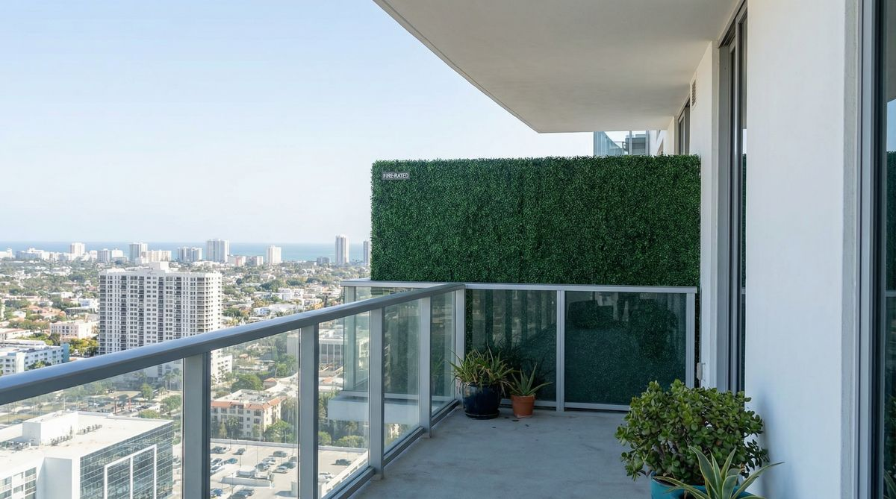
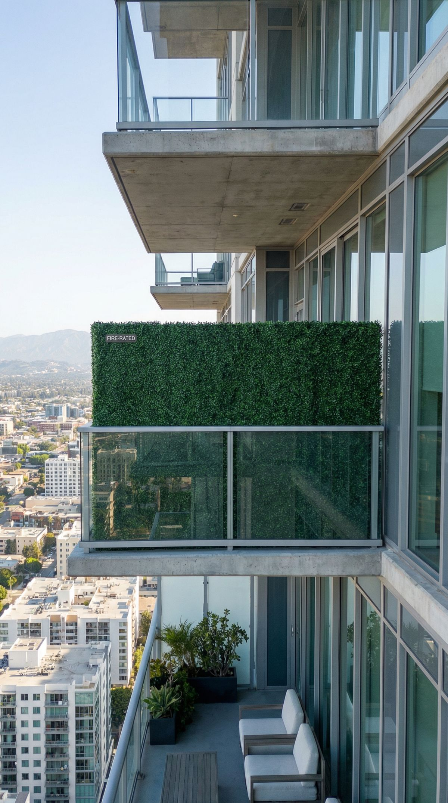

## Introduction  
Texas high-rise living comes with a unique set of challenges, especially when it comes to balcony landscaping. Real plants wilt under the scorching sun, require constant watering (a problem during droughts), and most critically, can become fire hazards in a state prone to wildfires. That’s where artificial fire rated hedges step in.  

These aren’t your grandma’s plastic plants. On our hedges, standard foliage is UV-stabilized for outdoor sun, and fire-rated foliage (NFPA 701[1]) is an upgrade at extra cost; ask for the NFPA 701 documentation for the exact system you choose. Some buyers also ask about California Title 19[2]. Good artificial hedges can look much like real boxwood or ivy, and UV-rated options are made for hot Texas summers. For homeowners in Dallas high-rises or Austin condos, it’s a way to get greenery without the risk or maintenance.  

The technology behind these products has advanced significantly in recent years. Some manufacturers build fire retardants into the material rather than relying only on surface treatments, which is worth asking about.  

## The Fire Safety Problem Nobody Talks About  
Most high-rise balconies in Texas are governed by fire codes that restrict combustible materials near the building, so check your local code. Real plants, even drought-resistant ones, dry out and become kindling. During wildfire season, embers can travel miles and land on your 30th-floor balcony.  

Artificial hedges solve this if they’re properly rated. The key is the flame-retardant treatment and the documentation behind it. Cheap faux plants can melt or drip when exposed to fire.  

Fire-rated artificial greenery is tested against a standard such as NFPA 701, which looks at flame spread and flaming drips.  

One thing to watch: not all “fire-resistant” products are equal. Look for explicit documentation for NFPA 701. Some sellers use vague terms like “fireproof” without testing. Always ask for the NFPA 701 documentation for the exact system you choose; reputable suppliers will provide it willingly.  

## How They Survive Texas Weather (When Real Plants Can’t)  
Central Texas summers destroy live hedges. Even native plants like yaupon holly need shade and daily watering, impossible on a west-facing balcony. Artificial hedges don’t just avoid dying; they avoid looking fake.  

The best ones use UV-stabilized polyethylene made to resist fading in direct sun. The material composition includes special additives that absorb UV radiation and convert it to harmless heat. Higher-end products use color-fast dyes that resist bleaching; ask for warranty terms in writing.  

Construction details matter too. Quality panels have varying leaf densities (sparser toward the center, denser at edges) to mimic natural growth patterns. The stems are often reinforced with flexible steel wires that allow for natural-looking arrangement while resisting wind damage. Some designs even incorporate brown "dead" leaves randomly throughout for added realism.  

Maintenance? A quick rinse with a hose every few months to remove dust. No fertilizers, no replacing dead sections, and no worrying about watering bans. For stubborn grime, a mild soap solution and soft brush will restore the vibrant color. Avoid pressure washers as they can damage the foliage texture.  

  

## Why Homeowner Associations Approve These (And Often Reject Real Plants)  
HOA rules in high-rises frequently ban live plants on balconies due to fire risks and maintenance concerns. But fire-rated artificial hedges often get approved because:  

- Fire-rated options can help with fire codes (submit the NFPA 701 documentation with your HOA application)  
- No watering means no leaks onto balconies below  
- Uniform appearance fits building aesthetics  
- Eliminate pest problems associated with soil and organic matter  

Some HOAs require specific colors or brands, check before buying. A few even have preferred vendors to maintain consistency across units. When submitting your request, include:  

1. Product specifications showing fire ratings  
2. Installation diagrams proving secure mounting  
3. Samples demonstrating the color matches building standards  
4. Maintenance guidelines showing minimal upkeep  

Pro tip: If your HOA is hesitant, offer to install a small test section for review before committing to the full balcony. Many boards become more receptive once they see the quality firsthand.  

## The Installation Secret for High-Rise Balconies  
Wind is the enemy on the 40th floor. Standard artificial hedges can sail away during a storm if not anchored properly. The fix?  

Professional installers use these techniques for secure high-rise applications:  

1. **Anchoring Systems**: Aluminum tracks screwed directly into balcony rails or walls using stainless steel hardware. The track system allows for thermal expansion during temperature swings.  

2. **Panel Connections**: Interlocking panel designs with overlapping edges prevent wind from getting underneath. Some systems use hidden clips that snap together for a seamless look.  

3. **Perimeter Sealing**: Silicone-based caulk applied at contact points prevents vibration and noise while creating a weather seal.  

Additional wind mitigation strategies:  
- Install vertical support posts at close spacing for extra tall panels  
- Use perforated or open-pattern panels in extremely windy locations  
- Add bottom weights in fabric pouches for temporary installations  

Spacing matters too. Leave a small gap between panels and walls to prevent heat buildup that could warp the material. In direct sun areas, consider light-colored backing material to reflect heat.  

## Frequently Asked Questions  

### Do fire rated hedges look cheap?  
Not the high-end ones. Premium artificial hedges use varied leaf patterns and color gradients to mimic real plants. Up close, you might see the difference, but from a neighbor’s balcony or street view, they’re indistinguishable.  

### How long do they last outdoors?  
Outdoor longevity depends on the product, UV treatment, exposure, and maintenance. Higher-quality materials generally hold up better than cheaper imports.

### Can I install them myself?  
Yes, if you’re comfortable drilling into balcony rails. For rentals or complex layouts, professional installation helps with building-code compliance.  

### Will they blow away?  
Not if installed correctly. Secure framing and tight panel connections help prevent movement; ask about wind loads for your site.  

### Are they safe for pets?  
Check the product's safety information. Even non-toxic materials can tempt some pets to chew (just like real plants).  

### Can fire rated hedges be customized to fit odd-shaped balconies?  
Many manufacturers offer custom sizing or trim-to-fit panels that can adapt to curved railings or angled corners. Some even provide templates for complex installations.  

### Do they provide any sound dampening benefits?  
While not their primary purpose, dense artificial hedge panels may slightly soften street noise, a bonus in urban high-rises near busy roads or construction sites.  

## Conclusion  
For Texas high-rise homeowners, artificial fire rated hedges check all the boxes: safety, durability, and zero maintenance. They can ease HOA headaches, hold up to the climate, and most importantly, reduce fire risks that real plants can’t.  

The initial investment in quality fire-rated artificial hedging can pay off through low upkeep. You may save on water bills, landscaping services, and potential fire damage repairs. As more Texas cities adopt stricter fire codes for high-rises, these solutions will likely become standard rather than optional.  

If you're tired of staring at a barren balcony, this might be the only solution that works long-term. Consult with a specialty supplier who understands local code requirements, and confirm the requirements with your local fire authority (AHJ), which makes the final call.  

## Related articles

This article is part of our [fire-rated artificial greenery guide for Texas commercial properties](/blog/fire-rated-artificial-greenery-for-texas-commercial-properties), which covers fire test standards, documentation, and compliance for commercial projects.

You might also find these useful:
- [Firewise artificial hedges for multifamily properties](/blog/firewise-artificial-hedges-for-multi-family-units)
- [The complete guide to artificial hedges in Texas](/blog/the-complete-guide-to-artificial-hedges-in-texas)

## References
[1] https://www.nfpa.org/codes-and-standards/all-codes-and-standards/list-of-codes-and-standards/detail?code=701
[2] https://www.dgs.ca.gov/BSC/Codes
