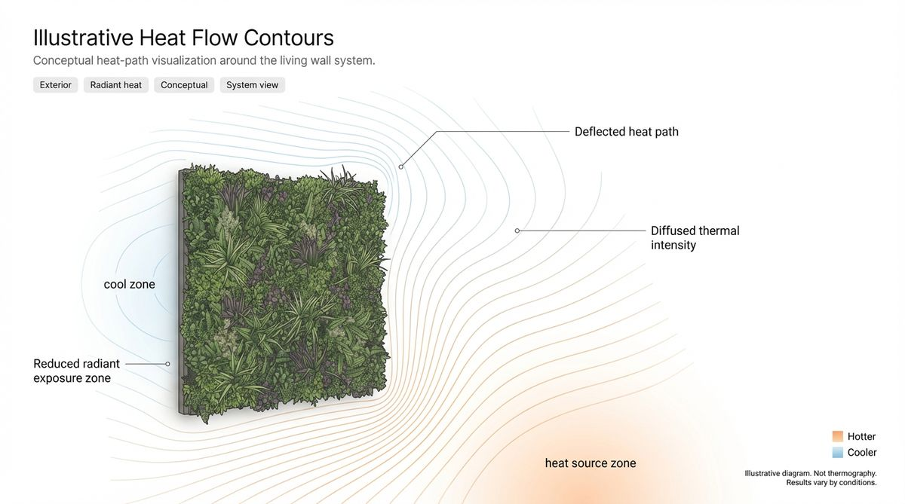
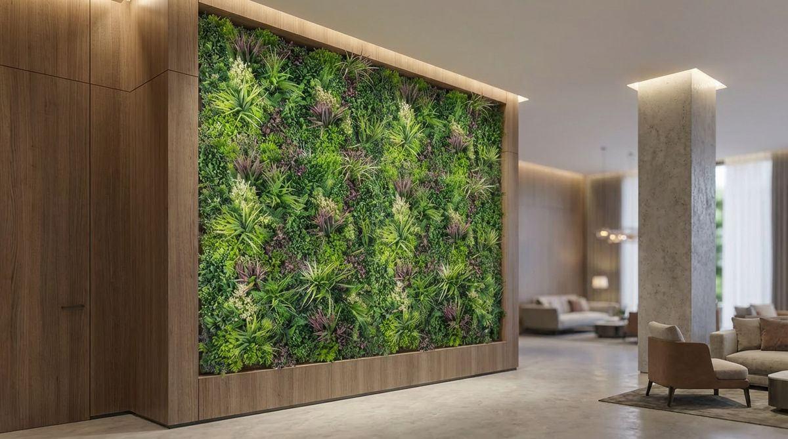
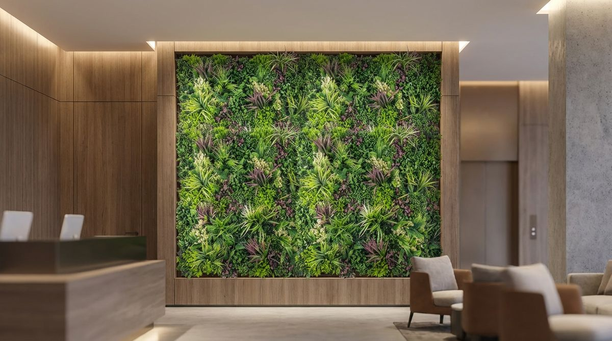

## Introduction  
Texas business owners face a dilemma: how to bring nature indoors without the headaches of live plants. Real greenery in office spaces comes with watering schedules, lighting requirements, and the inevitable brown leaves that make lobbies look neglected.  

Modern faux living walls solve these problems through advanced material science and design innovation. Today's premium artificial plants incorporate photorealistic details like veined leaves, natural color variations, and even simulated dew droplets. Some manufacturers use molds or scans of real plants to replicate leaf texture.  

The commercial advantages extend beyond aesthetics. Unlike live walls that require structural reinforcement for water reservoirs, faux installations use lightweight modular panels that can attach to standard drywall or concrete. This can reduce the need for structural modifications during retrofits.  

For facilities managers, the benefits can be measurable: less time spent on plant maintenance and no irrigation system to run.  

## Why Texas Offices Are Switching to Faux  

Many new Texas buildings include biophilic design elements. But Texas heat creates unique challenges for live plants, even indoors.  

Regional climate factors make faux walls particularly advantageous:  
- **Temperature fluctuations**: Glass curtain walls create greenhouse effects where lobby temperatures can swing widely between morning and afternoon. Live plants suffer stress from these rapid changes, while faux materials remain stable.  
- **HVAC challenges**: Forced air systems in dry West Texas climates desiccate live plants, while humid coastal air promotes mold growth in organic media. Synthetic plants eliminate both issues.  
- **Light exposure**: The intense Texas sun bleaches fabrics and fades artwork, live plants placed near windows often develop sunscald. UV-treated faux foliage maintains vibrancy without light filters.  

Maintenance comparisons reveal stark differences:  
- **Live walls** require:  
  - Dedicated irrigation systems with leak detectors  
  - Horticultural lighting for interior locations  
  - Weekly pH testing of hydroponic solutions  
  - Pest control for fungus gnats and spider mites  
- **Faux walls** need:  
  - Quarterly dusting with microfiber tools  
  - Occasional panel straightening  
  - UV coating refresh over time for sun-exposed areas  

The operational savings can compound over time through reduced maintenance costs.  

## Customization Options You Didn't Know Existed  

Standard pre-fab panels work for some, but Texas businesses often need tailored solutions. That's where fully custom faux walls shine.  

**Material innovations** now allow:  
- Variable density arrangements that create natural-looking growth patterns  
- Mixed media designs combining artificial mosses with sculptural branches  
- Interchangeable seasonal elements like autumn-toned maple leaves  

**Brand integration techniques** include:  
- Embossed metal logos embedded within foliage patterns  
- Custom color matching using spectrophotometer analysis  
- Illuminated signage backdrops with hidden LED strips  

**Structural adaptations** address practical concerns:  
- Retractable panels for access to electrical panels and plumbing  
- Magnetic mounting systems for temporary display walls  
- Antimicrobial coatings for healthcare environments  

Installation flexibility meets diverse needs:  
- Ceiling-hung "green clouds" for open atrium spaces  
- Freestanding room dividers with planter bases  
- Corner wrap designs that maximize small footprints  

  

A project with Lone Star Faux Scapes runs like this:  
1. You send your numbers  
2. We email an assessment and a rough quote (with a 3D render when it helps)  
3. A site review sets the final invoice  
4. We build, then install  

## Fire Safety You Can't Get With Real Plants  

NFPA 701 documentation[1] isn't just paperwork, it's what many fire-regulated spaces ask for. We supply fire-rated foliage (NFPA 701) as an upgrade at extra cost; ask for the NFPA 701 documentation for the exact system you choose. The test looks at flame spread and flaming drips.  

Key safety advantages over live plants:  
- **No combustible growing media** (soil, coco coir, peat moss)  
- **Zero moisture content** that could turn to steam in fires  
- **Non-nutritive** to prevent mold growth in wall cavities  

Building code considerations:  
- Many Texas cities adopt the International Fire Code, which points artificial decorative vegetation in many commercial buildings to NFPA 701, documented by the manufacturer  
- Requirements vary by city and code edition, so confirm with your local fire marshal  

Specialized applications demand extra precautions:  
- Hospitals specify wipeable antimicrobial surfaces  
- Schools require impact-resistant mounting systems  
- Data centers need static-dissipative materials  

Maintenance protocols ensure ongoing safety:  
- Annual inspection of mounting hardware  
- Verification of flame retardant coatings on fire-rated systems  
- Documentation of cleaning product compatibility  

## Installation Secrets for Texas Climates  

Proper installation accounts for regional environmental factors:  

**Coastal installations** require:  
- Salt-resistant stainless steel fasteners  
- Closed-cell foam backing to prevent moisture intrusion  
- Extra adhesive coverage for high humidity bonding  

**Desert installations** benefit from:  
- Thermal expansion joints in aluminum framing  
- Light-colored backing materials to reduce heat absorption  
- Anti-static treatments for dust-prone areas  

**Urban high-rises** present unique challenges:  
- Vibration-dampening mounts near elevator shafts  
- Reinforced edge detailing for cleaning equipment contact  
- Modular designs accommodating future reconfigurations  

Seasonal timing impacts results:  
- Spring installations allow material acclimation before summer heat  
- Fall projects avoid winter temperature extremes during curing  
- Avoid rainy seasons when humidity affects adhesive setting  

Professional installation teams should provide:  
- Laser leveling for seamless panel alignment  
- Custom cutting tools for precise perimeter fits  
- Post-installation tension adjustments as materials settle  

  

## Frequently Asked Questions  

  

How long do faux living walls last in direct sunlight?
  

Premium UV-stabilized materials usually hold color longer than cheaper imports, but performance still depends on product quality, placement, and light exposure. Look for polyethylene-based foliage rather than PVC for better outdoor durability.

  

  

Can these walls help with noise reduction?
  

They're not soundproof, but dense foliage panels can soften some sound. Pair them with acoustic backing to reduce echo, helpful in open-plan offices.  

  

  

What's the weight difference versus real plant walls?
  

Faux panels are much lighter than a live wall. A live wall with soil and irrigation can be very heavy when saturated, a real concern for upper-floor installations.  

  

  

How do you clean faux living walls?
  

Use compressed air for regular dust removal and a damp microfiber cloth for deeper cleaning now and then. Avoid harsh chemicals that could degrade UV coatings. For textured surfaces, soft-bristle brushes prevent particle buildup.  

  

  

Can faux walls be installed outdoors in Texas?
  

While possible, direct UV exposure and extreme weather accelerate wear. For outdoor applications, use corrosion-resistant framing and UV-rated foliage, and match the system to the amount of sun and weather exposure it will see.

  

  

Do faux living walls affect indoor air quality?
  

They don't actively purify air like live plants, but you can ask for a product's emissions documentation. Some projects look for third-party low-emission certification for sensitive environments.  

  

## Conclusion  

Faux living walls solve Texas-sized problems through innovative design and material science. They deliver biophilic benefits without the operational burdens of live plants, making them ideal for:  
- Corporate headquarters needing consistent first impressions  
- Medical facilities requiring hygienic surfaces  
- Educational institutions prioritizing safety and durability  

The technology continues advancing with new developments like:  
- Self-cleaning photocatalytic coatings  
- Interactive LED-integrated designs  
- Recyclable plant materials reducing environmental impact  

For Texas businesses, these systems represent more than decor, they're strategic investments in sustainable, low-maintenance design. The combination of aesthetic flexibility, fire-rated options where code calls for them, and operational savings creates compelling value propositions across industries.  

Ready to explore options for your space? [Lone Star Faux Scapes](/commercial-wall) serves commercial spaces across Texas. Here is how a project runs:  
- You send your numbers  
- We email an assessment and a rough quote (with a 3D render when it helps)  
- A site review sets the final invoice  
- We build, then install  

## Related articles

This article is part of our [complete guide to artificial living walls in Texas](/blog/the-complete-guide-to-artificial-living-walls-in-texas), which covers materials, indoor vs outdoor, commercial applications, installation, and more.

You might also find these useful:
- [Artificial living walls for Texas summers: what holds up when it's 105°F](/blog/artificial-living-walls-for-the-texas-summers)
- [Artificial vs. real living walls for Texas homes](/blog/artificial-vs-real-living-walls-for-texas-homes)

## References
[1] https://www.nfpa.org/codes-and-standards/all-codes-and-standards/list-of-codes-and-standards/detail?code=701
[2] https://www.austintexas.gov/department/codes-and-standards
